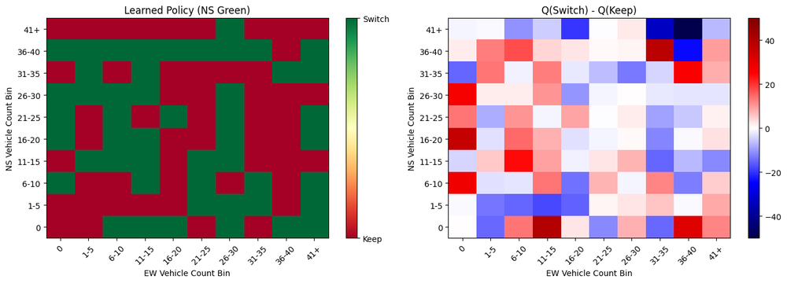
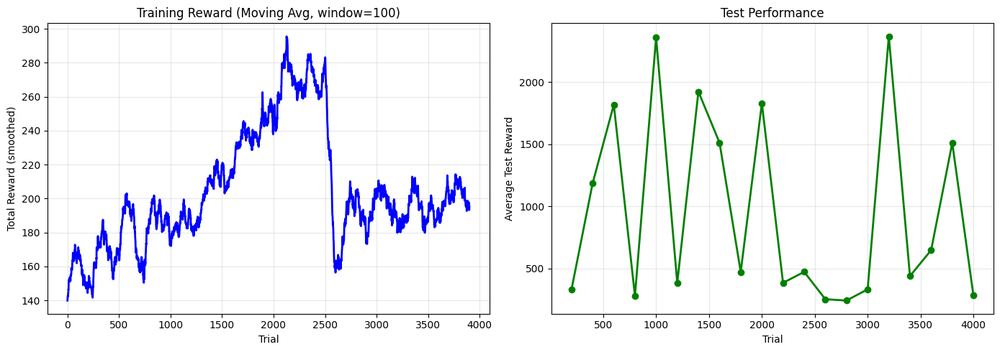

<div align="center">

# 🚦 Reinforcement Learning for Traffic Light Control: Paper Reproductions

**Re-implementing two milestone papers in RL-based traffic signal control: tabular SARSA(λ) from 1997 and a Double Dueling Deep Q-Network (3DQN) on the SUMO simulator from 2019.**


<a href="https://colab.research.google.com/github/minudakaliyanage/RTCW-Middle/blob/master/notebooks/thorpe1997_sarsa_and_liang2019_3dqn.ipynb"></a>


<br/><sub>Learned SARSA policy while North–South is green: switch vs keep for each combination of queue sizes</sub>

</div>

---

## 📌 Overview

Research coursework that traces how RL traffic-signal control has evolved by reproducing:

| | Paper | Method |
|---|---|---|
| **Implementation 1** (historical) | Thorpe, T. L. (1997). *Vehicle Traffic Light Control Using SARSA* | Tabular **SARSA(λ)** with eligibility traces |
| **Implementation 2** (middle) | Liang, X. et al. (2019). *A Deep Reinforcement Learning Network for Traffic Light Cycle Control* | **3DQN**: Double + Dueling DQN with prioritized experience replay |

## 1️⃣ Thorpe (1997): SARSA(λ)

- Single four-way intersection; the state is the **binned vehicle count** per direction plus the current light (the paper's *count representation*)
- Actions: **keep** or **switch** the green direction, with yellow, all-red and minimum-green constraints
- SARSA(λ) with ε-greedy exploration, trained for 4,000 trials

<p align="center"></p>

Compared on the paper's combined-load benchmark (total steps to clear traffic, lower is better), this implementation needs **2,075 steps**. The paper's SARSA count model needs 1,863 and fixed-duration control needs 1,917. The paper tuned α and λ for each traffic load; this run used a single setting, which explains much of the gap.

## 2️⃣ Liang et al. (2019): 3DQN on SUMO

- Intersection simulated in **SUMO**, with about 2,800–2,900 generated vehicles per episode
- **State:** 60×60 grid encoding vehicle **position and speed**
- **Action:** lengthen or shorten one phase of the light cycle by 5 seconds
- **Reward:** change in cumulative waiting time
- **Agent:** dueling value/advantage streams, a double-DQN target network and rank-based **prioritized replay**

| Method | Avg. waiting time (this run) | Paper |
|---|:-:|:-:|
| 3DQN | 66.0 s ± 6.3 | ~26 s |
| Fixed cycle, 30 s | 37.7 s ± 4.9 | ~35 s |
| Fixed cycle, 40 s | 51.8 s ± 5.1 | ~33 s |

The fixed-time baselines reproduce the paper's range, but the trained 3DQN agent **does not yet beat them**. This reproduction gap is documented in the evaluation section of the notebook, with differences in traffic generation, training length and hyperparameters as the main suspects.

## 📂 Files

| File | Description |
|---|---|
| `notebooks/thorpe1997_sarsa_and_liang2019_3dqn.ipynb` | ⭐ Both implementations end to end: SARSA, then SUMO setup, 3DQN training and evaluation |
| `notebooks/liang2019_3dqn_sumo.ipynb` | 3DQN + SUMO implementation on its own |
| `src/liang2019_3dqn_standalone.py` | Standalone 3DQN implementation with a lightweight Python traffic simulator (no SUMO needed) |
| `papers/` | Reference paper (Liang et al., 2019) |

## 🚀 Running

**Colab (recommended):** open a notebook with the badge above. The first cells install SUMO and its Python bindings.

**Locally (standalone script):**

```bash
pip install numpy tensorflow matplotlib
python src/liang2019_3dqn_standalone.py
```

---

<div align="center"><sub>Built by <a href="https://github.com/minudakaliyanage">Minudaka Liyanage</a></sub></div>
